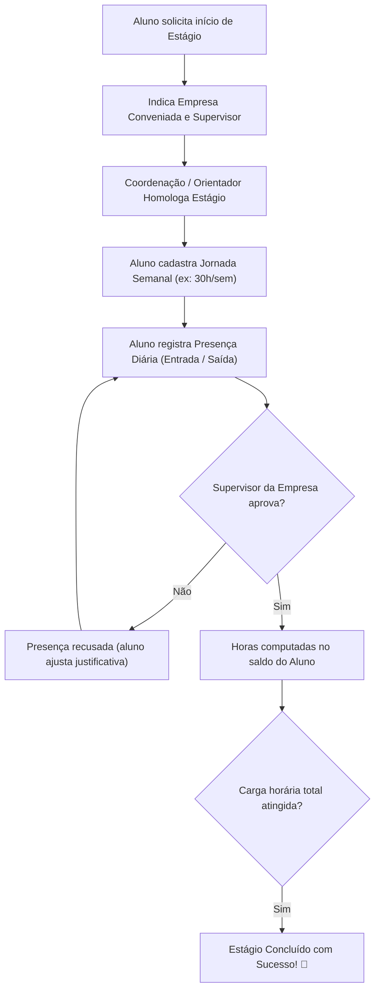
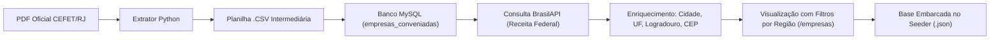

# 📘 Manual do Sistema & Guia do Desenvolvedor
### Portal de Estágio — CEFET/RJ

Bem-vindo ao guia completo do **Portal de Estágio do CEFET/RJ**. Este documento foi elaborado para ser extremamente didático, servindo tanto para novos desenvolvedores que estão entrando no projeto quanto para documentação de arquitetura, fluxo de dados e padronização de código.

---

## 📑 Sumário

1. [Visão Geral do Projeto](#1-visão-geral-do-projeto)
2. [Arquitetura & Tecnologias Utilizadas](#2-arquitetura--tecnologias-utilizadas)
3. [Perfis de Usuários & Suas Responsabilidades](#3-perfis-de-usuários--suas-responsabilidades)
4. [Fluxo de Dados & Regras de Negócio](#4-fluxo-de-dados--regras-de-negócio)
   - [4.1 Fluxo do Estágio e Frequência](#41-fluxo-do-estágio-e-frequência)
   - [4.2 Fluxo das Empresas Conveniadas & Localização via CNPJ](#42-fluxo-das-empresas-conveniadas--localização-via-cnpj)
5. [Tutorial de Instalação: Primeira Vez em uma Nova Máquina](#5-tutorial-de-instalação-primeira-vez-em-uma-nova-máquina)
6. [Como Rodar o Projeto no Dia a Dia](#6-como-rodar-o-projeto-no-dia-a-dia)
7. [Guia de Git, Commits & Boas Práticas](#7-guia-de-git-commits--boas-práticas)
8. [Estrutura de Pastas do Projeto](#8-estrutura-de-pastas-do-projeto)
9. [Solução de Problemas Comuns (Troubleshooting)](#9-solução-de-problemas-comuns-troubleshooting)

---

## 1. Visão Geral do Projeto

O **Portal de Estágio** é uma plataforma web desenvolvida para modernizar, digitalizar e centralizar todo o processo de gestão de estágios (obrigatórios e não obrigatórios) do **CEFET/RJ**.

### Principais Objetivos:
- **Alunos:** Facilitar a formalização do estágio, busca de empresas parceiras conveniadas e o controle digital diário de frequência/horas cumpridas.
- **Supervisores (Empresas):** Permitir a validação e assinatura rápida das folhas de ponto dos estagiários.
- **Professores Orientadores:** Acompanhar o cumprimento das metas acadêmicas e validar as horas de estágio para colação de grau.
- **Administração / DIPEX:** Gerenciar todos os convênios oficiais com empresas através de importação de documentos oficiais em PDF, enriquecimento de endereços via Receita Federal e auditoria geral dos usuários.

---

## 2. Arquitetura & Tecnologias Utilizadas

O sistema adota o padrão **MVC (Model-View-Controller)** com arquitetura de serviços desacoplada:

- **Backend:** [PHP 8.2+](https://www.php.net/) com framework [Laravel 12](https://laravel.com/).
- **Banco de Dados:** [MySQL 8.0](https://www.mysql.com/) rodando isolado em container Docker.
- **Frontend:** Laravel Blade, [Tailwind CSS](https://tailwindcss.com/) para design responsivo e [Vite](https://vitejs.dev/) como empacotador de assets.
- **Ambiente de Desenvolvimento:** [Docker](https://www.docker.com/) e **Docker Compose** para que ninguém precise instalar PHP, MySQL ou extensões diretamente no sistema operacional da máquina física.
- **Integração Externa:** [BrasilAPI](https://brasilapi.com.br/) para consulta pública e enriquecimento dos dados cadastrais das empresas diretamente da Receita Federal a partir do CNPJ.
- **Processamento de Documentos:** Script auxiliar em Python para extração tabular e tratamento de anomalias em PDFs de convênios.

---

## 3. Perfis de Usuários & Suas Responsabilidades

O sistema possui 4 tipos de usuários, cada um com visão e permissões bem definidas:

| Perfil | Acesso Principal | O que faz no sistema? |
|---|---|---|
| 🎓 **Aluno** | `/dashboard`, `/estagios`, `/empresas`, `/controle-horas` | Inicia o processo de estágio, cadastra sua jornada semanal, bate o ponto diário (registro de presença), visualiza empresas parceiras com convênio ativo e consulta seu saldo de horas. |
| 🏢 **Supervisor** | `/dashboard`, `/estagios` | Representa a empresa concedente. Analisa as presenças e horas lançadas pelo estagiário e aprova ou recusa as justificativas com parecer. |
| 👨‍🏫 **Orientador** | `/dashboard`, `/estagios` | Professor do CEFET/RJ responsável pedagogicamente pelo estágio. Valida relatórios e homologa a carga horária acadêmica. |
| 🛡️ **Administrador** | `/admin/empresas`, `/admin/usuarios`, `/admin/tables` | Equipe de estágios/coordenação. Importa PDFs oficiais de convênios, busca localização via CNPJ, edita/apaga registros e gerencia cadastros de alunos e orientadores. |

---

## 4. Fluxo de Dados & Regras de Negócio

### 4.1 Fluxo do Estágio e Frequência



1. **Jornada:** Define a grade de horários combinada (ex: Segunda a Sexta, das 08h às 14h).
2. **Presença:** Pode ser no modo `oficial` ou `pessoal`. Só é contabilizada no progresso oficial após parecer favorável do supervisor.
3. **Vigência do Convênio:** O aluno só pode formalizar estágio com empresas cujo convênio esteja com a data de validade ativa (`isVigente() = true`).

---

### 4.2 Fluxo das Empresas Conveniadas & Localização via CNPJ



1. **Importação do PDF:** O administrador faz o upload do PDF oficial da DIPEX em `/admin/empresas`.
2. **Tratamento Inteligente:** O extrator corrige erros comuns de digitação em PDFs oficiais (ex: anos `20222 -> 2022`, dias `29/02` em anos não bissextos, meses com 3 dígitos) e infere a vigência padrão de 5 anos do CEFET caso falte data.
3. **Verificação de Localização (BrasilAPI):** O administrador clica em *"Buscar Localização via CNPJ"*. O sistema faz requisições assíncronas à BrasilAPI respeitando o limite de requisições, obtendo município, estado e endereço fiscal.
4. **Base Pré-Embarcada (Zero Espera):** O projeto já inclui todas as 1.608 empresas e 1.462 cidades pré-salvas no arquivo `database/seeders/data/empresas_conveniadas.json`. Assim, quem clona o projeto já tem todas as empresas prontas instantaneamente via `php artisan db:seed`!

---

## 5. Tutorial de Instalação: Primeira Vez em uma Nova Máquina

Siga este passo a passo para configurar e rodar o projeto do absoluto zero em qualquer computador (Windows, Linux ou macOS).

### 📋 1. Pré-Requisitos Necessários
Você só precisa ter instalado na sua máquina física:
1. **[Git](https://git-scm.com/downloads)**
2. **[Docker Desktop](https://www.docker.com/products/docker-desktop/)** (certifique-se de que o Docker esteja aberto e em execução).

> [!NOTE]
> Você **NÃO** precisa instalar PHP, Composer, Node.js, Python ou MySQL na sua máquina física. O Docker cuidará de tudo automaticamente dentro dos containers!

---

### 📥 2. Clonando o Repositório
Abra o seu terminal (PowerShell no Windows, ou Terminal no Linux/macOS) na pasta onde você guarda seus projetos (ex: `C:\Projetos`):

```bash
git clone URL_DO_SEU_REPOSITORIO portal-de-estagio
cd portal-de-estagio
```

---

### ⚙️ 3. Configurando o Arquivo de Variáveis de Ambiente (`.env`)
Copie o arquivo de exemplo para criar o seu `.env`:

*No Windows (PowerShell):*
```powershell
copy .env.example .env
```
*No Linux / macOS:*
```bash
cp .env.example .env
```

Abra o arquivo `.env` em seu editor e certifique-se de que a seção de banco de dados esteja exatamente assim:

```env
DB_CONNECTION=mysql
DB_HOST=db
DB_PORT=3307
DB_DATABASE=projeto
DB_USERNAME=root
DB_PASSWORD=
```

---

### 🐳 4. Subindo os Containers Docker
Execute o comando abaixo para construir a imagem e iniciar os containers do Laravel e do MySQL em segundo plano:

```bash
docker compose up -d --build
```
> Aguarde alguns minutos na primeira vez enquanto o Docker baixa as imagens e prepara o ambiente.

Para conferir se os containers estão rodando:
```bash
docker ps
```
Você deverá ver `portal-de-estagio-app-1` e `portal-de-estagio-db-1` com status **Up**.

---

### 📦 5. Instalando Dependências & Preparando o Banco
Execute a sequência de comandos abaixo dentro do container:

```bash
# 1. Instalar dependências do PHP/Laravel
docker compose exec app composer install

# 2. Gerar a chave criptográfica da aplicação
docker compose exec app php artisan key:generate

# 3. Executar as migrations (criação de todas as tabelas)
docker compose exec app php artisan migrate

# 4. Popular o banco com os dados iniciais (Admin + Empresas + Cidades)
docker compose exec app php artisan db:seed

# 5. Instalar pacotes do frontend e compilar assets
docker compose exec app npm install
docker compose exec app npm run build

# 6. Limpar e otimizar os caches do Laravel
docker compose exec app php artisan optimize:clear
```

---

### 🚀 6. Acessando a Aplicação!
Abra o seu navegador e acesse:

👉 **[http://localhost:8000](http://localhost:8000)**

#### 🔑 Usuário Administrador Padrão (criado pelo Seeder):
- **E-mail:** `admin@cefet.br`
- **Senha:** `admin123`

---

## 6. Como Rodar o Projeto no Dia a Dia

Depois que o projeto já foi instalado pela primeira vez, você **não precisa repetir** os passos de instalação! No seu dia a dia de trabalho:

### ▶️ Para Iniciar o Projeto:
Abra o terminal na pasta do projeto e execute:
```bash
docker compose up -d
```
Pronto! O sistema já estará disponível em `http://localhost:8000`.

### ⏹️ Para Parar o Projeto:
Quando terminar o dia de trabalho:
```bash
docker compose down
```
*(Seus dados no banco de dados não serão perdidos, pois estão salvos no volume `dbdata` do Docker).*

---

### 🎨 Se estiver alterando arquivos de estilo (CSS / Tailwind / JS):
Se você for alterar interfaces Blade e quiser recarregamento em tempo real (Hot Reload):
```bash
docker compose exec app npm run dev
```

---

### 🛠️ Comandos Úteis do Dia a Dia:

| O que você quer fazer? | Comando no terminal |
|---|---|
| Acessar o terminal bash dentro do container | `docker compose exec app bash` |
| Ver logs do Laravel em tempo real | `docker compose exec app tail -f storage/logs/laravel.log` |
| Limpar todos os caches do Laravel | `docker compose exec app php artisan optimize:clear` |
| Rodar enriquecimento de empresas via CNPJ | `docker compose exec app php artisan empresas:enriquecer --limite=50` |
| Salvar base atual de empresas no seeder | `docker compose exec app php artisan empresas:salvar-seeder` |
| Recriar o banco do zero e repopular tudo | `docker compose exec app php artisan migrate:fresh --seed` |

---

## 7. Guia de Git, Commits & Boas Práticas

Para manter o repositório do projeto limpo, organizado e evitar conflitos com outros membros da equipe, siga este fluxo de trabalho profissional.

### 🌅 Início do Dia: Sincronize com o Repositório
Antes de começar a escrever qualquer linha de código:
```bash
git checkout main
git pull origin main
```

---

### 🌿 Crie uma Branch para a sua Tarefa
Evite fazer alterações diretamente na branch `main`. Crie uma branch específica para o que você vai desenvolver:

```bash
# Formato: tipo/descricao-curta
git checkout -b feature/filtro-empresas
# ou
git checkout -b fix/correcao-data-nula
```

---

### 🔍 Verifique o que foi modificado
Antes de commitar, inspecione seus arquivos:
```bash
git status
git diff
```

---

### ✍️ Padrão de Mensagens de Commit (Conventional Commits)
Escreva commits claros e objetivos, usando prefixos padronizados:

- `feat:` Nova funcionalidade para o usuário (ex: `feat: adicionar filtro de empresas por UF`).
- `fix:` Correção de um bug ou erro (ex: `fix: tratar datas nulas na importacao do pdf`).
- `docs:` Alterações em documentação ou tutoriais (ex: `docs: atualizar guia de instalacao`).
- `style:` Formatação de código ou ajustes puramente visuais sem alteração de regra.
- `refactor:` Refatoração de código sem mudar o comportamento da funcionalidade.

#### Exemplo de comando:
```bash
git add .
git commit -m "feat: adicionar busca automatica de localizacao via cnpj"
```

---

### 🚀 Enviando suas Alterações para o GitHub/GitLab:
```bash
git push -u origin sua-branch
```
Depois abra o **Pull Request (PR)** na plataforma para revisão e merge na branch `main`.

> [!WARNING]
> **O que NUNCA commitar no Git:**
> - Arquivos com senhas ou credenciais reais (`.env`).
> - Pastas pesadas de dependências (`vendor/`, `node_modules/`).
> - Caches locais (`storage/framework/cache/`, `.phpunit.result.cache`).
> *(Todos esses itens já estão protegidos no `.gitignore`)*.

---

## 8. Estrutura de Pastas do Projeto

Conheça as principais pastas para saber exatamente onde encontrar ou criar cada arquivo:

```
portal-de-estagio/
├── app/
│   ├── Console/Commands/      # Comandos artisan customizados (CLI)
│   ├── Http/
│   │   ├── Controllers/       # Lógica das rotas (Admin, Empresas, Estagios...)
│   │   └── Middleware/        # Filtros de autenticação e proteção de rotas
│   ├── Models/                # Entidades do banco de dados (Eloquent ORM)
│   └── Services/              # Regras de negócio complexas e integrações (BrasilAPI, PDF...)
├── database/
│   ├── migrations/            # Histórico e versionamento das tabelas do banco
│   └── seeders/               # Dados iniciais para popular o sistema
│       └── data/              # Base estática JSON das empresas conveniadas
├── resources/
│   ├── css/                   # Estilos Tailwind CSS
│   ├── js/                    # Scripts do frontend
│   └── views/                 # Telas em Blade (HTML dinâmico)
│       ├── admin/             # Telas exclusivas do Administrador
│       └── partials/          # Componentes reutilizáveis (navbars, cards...)
├── routes/
│   └── web.php                # Todas as URLs e rotas da aplicação
├── scripts/                   # Scripts utilitários (ex: extrator de PDF em Python)
├── storage/                   # Uploads temporários, logs e arquivos gerados
├── tutoriais/                 # Manuais e guias práticos do desenvolvedor
├── docker-compose.yml         # Definição dos containers Docker (app + mysql)
└── Dockerfile                 # Configuração do ambiente PHP, extensões e Node
```

---

## 9. Solução de Problemas Comuns (Troubleshooting)

### 🔴 O Docker deu erro de porta já em uso (`Port 8000 or 3307 is already allocated`)
- **Causa:** Outro programa ou container já está usando essa porta na sua máquina.
- **Solução:** Pare os outros containers com `docker stop $(docker ps -q)` ou verifique se você não tem outro servidor local (como XAMPP ou outro MySQL) aberto.

### 🔴 As páginas estão sem formatação CSS ou ícones quebrados
- **Causa:** Os assets do Vite ainda não foram compilados no container.
- **Solução:** Execute:
  ```bash
  docker compose exec app npm run build
  ```

### 🔴 Erro de permissão em pastas do storage (`Permission denied`)
- **Solução:** Execute no terminal:
  ```bash
  docker compose exec app chmod -R 777 storage bootstrap/cache
  ```

### 🔴 Alterei uma migration e preciso resetar o banco
- **Solução:** Para recriar o banco do zero com todas as tabelas e dados já populados:
  ```bash
  docker compose exec app php artisan migrate:fresh --seed
  ```

---

<p align="center">
  <b>Portal de Estágio — CEFET/RJ</b><br>
  Desenvolvido com foco em produtividade, segurança e excelência acadêmica.
</p>
